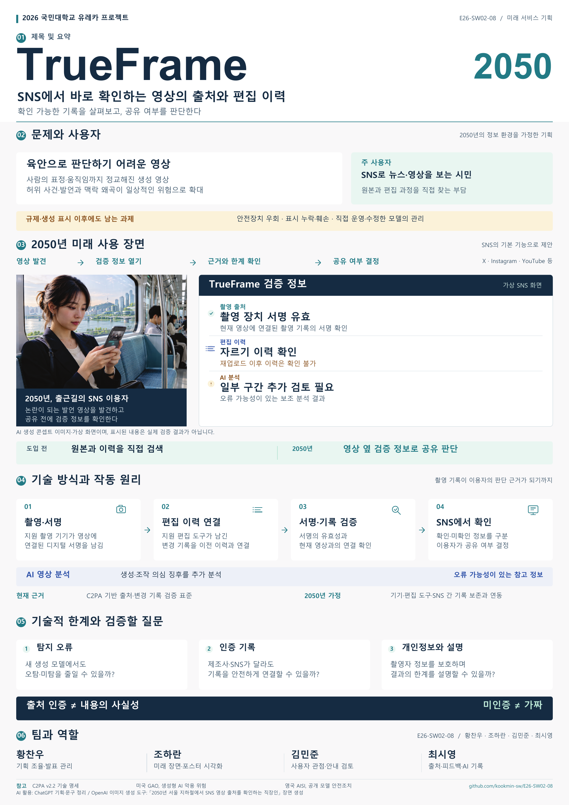

# Welcome to E26-SW02-08

## 🎯 팀 슬로건

> 개미같이 공부하고 베짱이처럼 놀자

## 🖼️ TrueFrame 최종 포스터·발표자료

**TrueFrame 2050 — SNS에서 바로 확인하는 영상의 출처와 편집 이력**

<div class="poster"><a href="최종발표/TrueFrame_포스터_최종_A0.pdf"></a></div>

<p align="center" class="poster-caption"><sub>2050년 SNS의 기본 기능으로 제안한 미래 서비스 기획입니다. AI 생성 콘셉트 이미지와 가상 검증 화면을 포함하며, 실제 SNS 기능이나 실제 검증 결과를 뜻하지 않습니다.</sub></p>

- [포스터 최종 — A0 인쇄·발표용 PDF](최종발표/TrueFrame_포스터_최종_A0.pdf)
- [발표용 최종 대본 — 포스터 01~06 순서](최종발표/TrueFrame_발표용_대본.md)
- [포스터 편집 원본 — A0 한 장짜리 PowerPoint](최종발표/TrueFrame_포스터_편집원본_A0.pptx)
- [AI 활용·이미지 프롬프트·참고자료](최종발표/AI_활용_및_제작기록.md)

포스터는 **A0 세로형 841 × 1,189mm, 1페이지 CMYK PDF**입니다. 글자·도식은 벡터이며 사진의 실효 해상도는 약 155 DPI입니다. 발표는 포스터를 열어 진행하며, 파일과 화면 준비 시간을 포함해 총 5분 이내로 연습합니다.

***

## 1️⃣ 팀원 소개

| **이름** | **전공** | **관심사** |
| --- | --- | --- |
| **황찬우** | 소프트웨어학부 | 백엔드, 하네스 엔지니어링, 취업 |
| **조하란** | 소프트웨어학부 | 인공지능, 인공신경망, NLP, 앱 프로그래밍|
| **최시영** | 소프트웨어학부 | 스타트업, 창업, 소프트웨어 개발, 인공지능 |
| **김민준** | 소프트웨어학부 | 취업, 경제적 안정, 여가생활 |

유레카프로젝트 팀 생성을 축하합니다.
팀의 제목과 슬로건, 팀원의 이름 및 관심사를 변경하세요.

### 팀 소개

팀의 소개를 작성합니다.

***

## 2️⃣ 공통된 관심사 : 여행, 백엔드, 인공지능

***

## 3️⃣ 한학기 동안의 활동 내역 

- 기관/부서 인터뷰 ✔️  

- 현장 탐방 ✔️  

- 멘토링 ✔️  
  - 내 지도 교수 함게 만나기
  - 대학원 방문 및 선배 만나기

- 프로젝트 진행 ✔️  
  - 과거에 사람들이 상상한 미래
  - 그들이 만들어가는 세상
  - 우리가 상상한 미래
  - 우리가 그리는 미래 그리고 나

- 각오와 소감 나누기 ✔️  


<!-- 활동 사진 추가 예시 -->


***

## 4️⃣ 인상 깊은 활동

- 활동명 – 활동에 대한 간단한 설명과 배운 점을 작성  
- 예: 멘토링에서 실리콘밸리 현업 경험을 들을 수 있어 진로 방향 설정에 큰 도움이 되었다.  

***

## 5️⃣ 특별히 알아보고 싶은 것
- 성적 A+
- 졸업 후 진로(대학원/취업)

***

## 6️⃣ 활동을 마친 소감

🔗학번 이름  
> "소감 내용을 여기에 작성합니다."

🔗학번 이름  
> "소감 내용을 여기에 작성합니다."

🔗학번 이름  
> "소감 내용을 여기에 작성합니다."

🔗학번 이름  
> "소감 내용을 여기에 작성합니다."


## Markdown을 사용하여 내용꾸미기를 익히세요.

Markdown은 작문을 스타일링하기위한 가볍고 사용하기 쉬운 구문입니다. 여기에는 다음을위한 규칙이 포함됩니다.

```markdown
Syntax highlighted code block

# Header 1
## Header 2
### Header 3

- Bulleted
- List

1. Numbered
2. List

**Bold** and _Italic_ and `Code` text

[Link](url) and 
```

자세한 내용은 [GitHub Flavored Markdown](https://guides.github.com/features/mastering-markdown/).

### Support or Contact

readme 파일 생성에 추가적인 도움이 필요하면 [도움말](https://help.github.com/articles/about-readmes/) 이나 [contact support](https://github.com/contact) 을 이용하세요.

