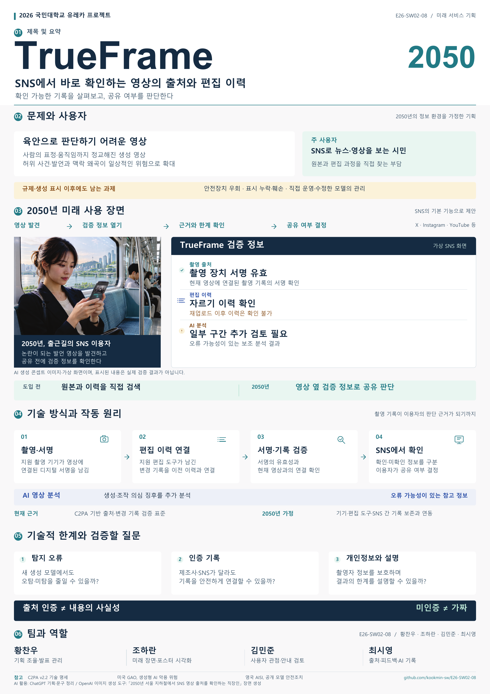

# TrueFrame — 최종 포스터·발표자료

2026년 11월 6일 유레카 프로젝트 발표용 자료입니다.

| 자료 | 용도 |
|---|---|
| [포스터 최종 A0 PDF](TrueFrame_포스터_최종_A0.pdf) | GitHub에서 열어 발표하거나 A0 실제 크기로 인쇄 |
| [발표용 대본](TrueFrame_발표용_대본.md) | 포스터의 01~06 번호 순서로 설명 |
| [포스터 미리보기](TrueFrame_포스터_미리보기.png) | 전체 배치와 내용을 빠르게 확인 |
| [PowerPoint 편집 원본](TrueFrame_포스터_편집원본_A0.pptx) | A0 한 장의 글자·도형·사진 수정 |
| [AI 활용 및 제작 기록](AI_활용_및_제작기록.md) | 생성 프롬프트, 참고 출처, 제작 방식 |

- 최종 PDF: A0 세로형 841 × 1,189mm, 1페이지, CMYK. 글자·도식은 벡터, 사진은 배치 크기 기준 약 155 DPI.
- 발표: 별도 슬라이드 묶음 없이 포스터 1장을 사용합니다. 말하는 분량은 약 4분을 목표로 하며 파일 열기·화면 준비를 포함해 총 5분 이내로 연습합니다.
- 편집 원본: RGB, Windows 기본 맑은 고딕·Arial 사용. 수정 후 인쇄용 PDF의 크기와 색상 모드를 다시 확인하세요.
- 2050년 SNS 기본 기능을 상상한 기획입니다. 장면 사진과 검증 화면은 가상이며, 실제 SNS 탑재나 실제 탐지 성능을 주장하지 않습니다.
